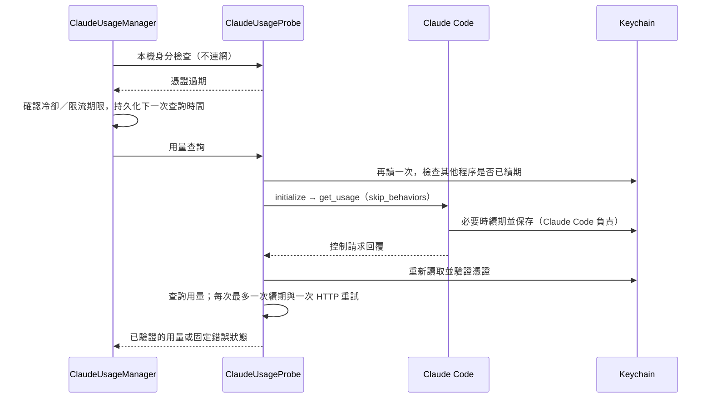

# Claude 用量：自動續期

- 日期：2026-11-12（Asia/Taipei）。
- 基準：`12216ba`；分支 `codex/fix-claude-usage-auto-renewal`。
- 範圍：Claude 用量憑證恢復、背景排程、錯誤提示與回歸測試。

## 行為

先前遇到 access token 過期或 HTTP 401 就顯示登入過期。本次在可續期的情況下，透過已安裝的 Claude Code 查詢內建用量，讓官方程式處理 OAuth 續期、跨程序鎖定與憑證保存，再重新讀取憑證並重試用量。



- `ClaudeUsageParser` 只把 refresh token 是否存在／尚未過期轉為 `canRenew`，不把原值傳出 helper、保存到快取或交給子程序。
- `ClaudeUsageProbe.recover` 合併並行續期，並設 300 秒 helper 冷卻。一般 HTTP／429／403 錯誤不啟動續期；重讀時發現其他程序已換成有效 token 就直接使用。
- `ClaudeUsageManager` 保留 identity-only 不連網的契約。身分檢查發現過期後，才在既有 HTTP 門檻允許時送用量請求。五分鐘門檻、服務端 Retry-After、重啟與 Connect 均不能繞過。
- CLI 回覆成功可能來自快取，也可能未含用量資料，不能當作續期成功。重新讀取仍過期、或重試後仍收到 401，顯示 `renewalFailed`。缺少可用 refresh token 時保留 `expiredLogin`；不相容的 CLI／協定顯示 `renewalUnavailable`。

## CLI 邊界

實測版本為 Claude Code `2.1.311`。使用 `--print --input-format stream-json --output-format stream-json`，只傳 `initialize` 與 `get_usage` 兩個控制請求，不傳 `user` 訊息或 `/usage` 聊天 prompt。`skip_behaviors: true` 避免掃描本機對話紀錄。

啟動時啟用 safe mode、停用 session persistence、設定來源、工具與 MCP。環境只沿用必要的使用者／系統／proxy 欄位，使用真實使用者的預設 home；不繼承其他 provider、`CLAUDE_CONFIG_DIR`、token 或 Node/Bun 注入設定，避免查詢另一個帳號。工作目錄為 `/`。

程序有 90 秒期限與 1 MiB 累計輸出上限；stdin/stdout 使用 pipe，stderr 丟棄，沒有 shell。互動授權、工具或 assistant 訊息會停止流程。成功回覆必須包含零模型費用、零模型 API 時間、空 `model_usage` 與空 `behaviors`；結束時關閉 pipe、TERM，必要時一秒後 KILL 並由 Process 回收。

`get_usage` 是本機 CLI 內的實驗性控制協定，不是 Anthropic 保證穩定的公開續期 API；不支援時不回退為模型對話。CLI 的快取、限流、網路及官方登入狀態仍可能阻止當次續期。refresh token 已失效時仍需在 Claude Code 重新登入。此功能不保證外部程序同時鎖定 Keychain 或改 ACL 時絕不出現系統提示。

CLI 參數與認證生命週期參考：[CLI reference](https://code.claude.com/docs/en/cli-reference)、[Authentication](https://code.claude.com/docs/en/authentication)。控制協定另以本機分發程式與真實回覆核對。

## 驗證入口

```sh
# Debug build 之後；全部使用離線 fixture，不存取真實登入。
bash scripts/check-claude-usage.sh /path/to/DerivedData/Build/Products/Debug
bash scripts/check-codex-usage.sh /path/to/DerivedData/Build/Products/Debug
bash scripts/check-concurrency.sh /path/to/DerivedData/Build/Products/Debug

# 明確 opt-in：使用既有登入；可能由 Claude Code 自動續期。
# 不修改真實 expiry、不強制登出、不建立模型對話、不輸出 token。
bash scripts/check-claude-renewal-live.sh --run
```

離線檢查涵蓋本機過期、401 後恢復、重試仍 401、CLI 空回覆與未更新 token、並行合併、跨程序已輪替、缺少／過期 refresh token、限流、重啟與重複 Connect。程序 fixture 檢查訊息內容、分段輸出、通知穿插、不支援／互動協定、模型用量非零、超量輸出、EOF、逾時、取消與拒絕 TERM 後清理。

真實檢查已確認 production 控制協定與零模型用量驗證通過，重新讀取憑證及用量查詢成功。當時真實 token 尚未過期且未變更，所以沒有把這次 smoke check 當成真實過期後續期驗收；過期恢復目前以離線 fixture 驗證。尚未安裝新版 App 或驗證完整 App 的長時間背景輪詢。

2026-11-12 驗證結果：

| 檢查 | 結果 |
|---|---|
| Xcode Debug／Release | 通過；保留既有本機固定簽署設定。Release `codesign --verify --deep --strict` 通過。 |
| Claude 回歸 | 343 項通過：Probe 127、Keychain preflight 46、系統工具 58、續期協定／程序 70、Manager／cache 42。 |
| Codex 用量 | 43 項 probe 與 45 項 manager／history 通過。 |
| 並行／月曆／真實 anonymous XPC | 71 項通過。 |
| 音訊回呼 | Debug／最佳化合計 52 項通過。 |
| 靜態檢查 | `git diff --check`、shell／Python fixture 語法與文件本機連結通過。 |

建置環境仍回報既有 AppIntents metadata 提示及 iOS Simulator 元件版本不符；本次 macOS 建置成功，未新增 Swift／linker 警告。暫存 log 位於 `/tmp/boring-notch-claude-renewal/`，不納入提交。
